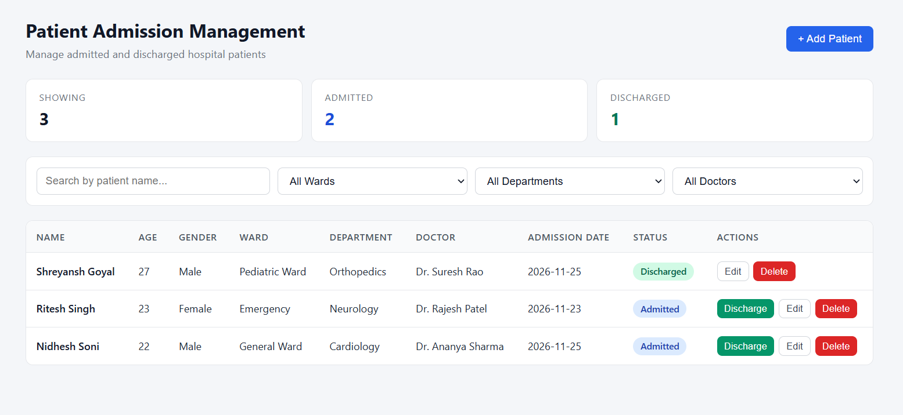
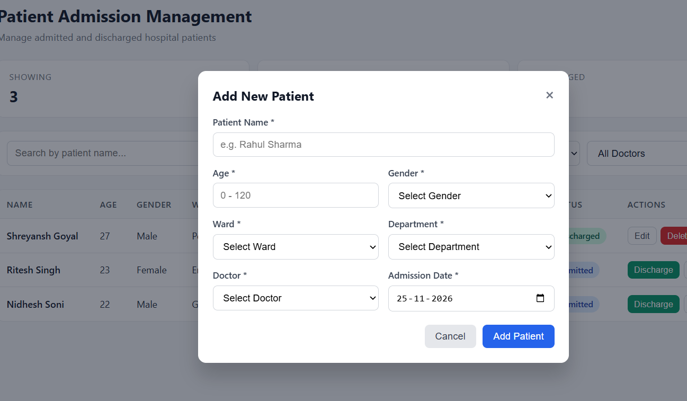
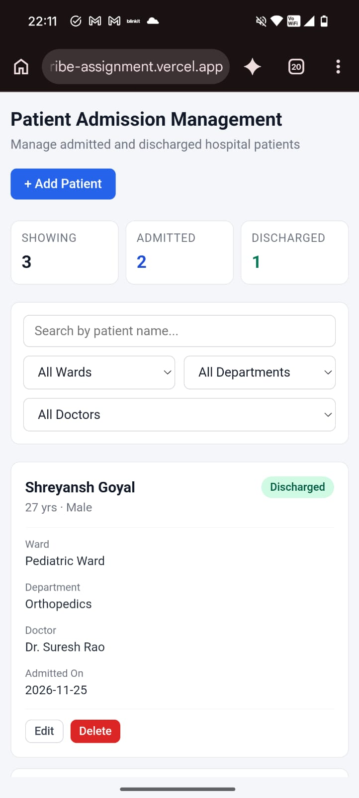

# Patient Admission Management App

A web application for hospital staff to manage admitted and discharged patients.

## Live Link

- **Frontend:** https://dscribe-assignment.vercel.app/
- **Backend API:** https://dscribe-assignment.onrender.com

## Tech Stack

- **Frontend:** React.js (Vite)
- **Backend:** Python (Flask, Flask-CORS, Gunicorn)
- **Database:** SQLite (`sqlite3`)

## Features

- Add a new patient
- View all patients with summary counts (Showing, Admitted, Discharged)
- Search patients by name
- Filter by Ward, Department, and Doctor
- Edit patient details
- Delete a patient with confirmation dialog
- Mark a patient as Discharged
- Frontend and backend validation on all fields
- Responsive layout for mobile, tablet, and desktop

## Project Structure

```text
├── backend/
│   ├── app.py
│   ├── db.py
│   ├── constants.py
│   ├── validators.py
│   ├── controllers/
│   │   └── patient_controller.py
│   ├── routes/
│   │   └── patient_routes.py
│   ├── Procfile
│   └── requirements.txt
└── frontend/
    ├── src/
    │   ├── api.js
    │   ├── constants.js
    │   ├── App.jsx
    │   ├── App.css
    │   └── components/
    │       ├── FilterBar.jsx
    │       ├── PatientList.jsx
    │       ├── PatientForm.jsx
    │       └── ConfirmModal.jsx
    └── package.json
```

## Steps to Run Locally

### 1. Backend (Flask)

```bash
cd backend
python -m venv .venv
# Windows
.venv\Scripts\activate
# macOS / Linux
source .venv/bin/activate

pip install -r requirements.txt
python app.py
```

The backend runs on `http://localhost:5000` and creates `patients.db` automatically.

### 2. Frontend (React)

```bash
cd frontend
npm install
cp .env.example .env
npm run dev
```

Open `http://localhost:5173` in your browser.

## Screenshots

> Add screenshots of the desktop view, mobile view, and Add/Edit Patient form here after deploying.






